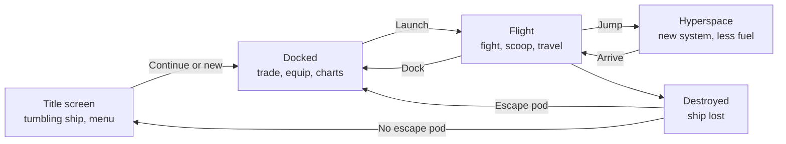

# Design for the rest of Ace Commander

First draft, 2026-11-13, with Brian's decisions of the same day written in (see
[Decisions](#decisions)). Phase 1 is built and has been played on the badge (build 15);
nothing after it has been built or tested yet.

## Summary

This design turns the flight demo into the full Elite loop: launch from a station, trade
between systems, fight on the way, dock and upgrade. It is split into phases, and the game
stays playable after each one.

What exists today (build 13): wave-based flight combat, a ship viewer, a speed test, and 31
ships with their original energy, speed, laser and missile stats. On the badge it runs at
about 15 to 20 frames a second, with a stutter every few seconds that is still being
diagnosed.

Facts about how original Elite works are from memory and marked as such; they get checked
against the source when each part is built.

| Constraint | What it means for the design |
| --- | --- |
| Round 240 px screen | Lists show 6 or 7 rows and scroll. Wide tables are split across screens. |
| Digital joystick and six buttons | Every screen works with joystick, C to act and F to go back. No typing needed. |
| Plain MicroPython, no firmware build | All new code is MicroPython. Game rules stay free of badge imports so they test on a PC. |
| Measured drawing costs: rectangle 0.03 ms, line 0.35 ms, text 4 ms | Text-heavy screens redraw only when something changes. Anything animated avoids text. |
| About 33 ms of every frame is outside the app | Flight can't go much above 20 frames a second, so new space objects must stay cheap. |
| Elite's data has no licence | Galaxy, market and text data are generated locally from your own copy, like `ship_data.py`. |

## The game loop

The player goes round one loop: dock, launch, fly, jump, fly, dock. Being destroyed returns
you to the station if you have an escape pod, and to the title screen if you don't.

Combat practice, the ship viewer and the speed test hang off the title screen and return to
it. They sit outside the loop and don't touch the saved commander.

## Title screen

The start screen shows a ship tumbling slowly in space above the title, as the original
does. It replaces the plain three-line menu.

- **Ship:** a wireframe with hidden lines removed, turning on two axes at once so it tumbles
  and does not just spin. It uses the ship viewer's drawing code, so there is little new work.
- **Which ship:** the Cobra Mk III first. After about 8 seconds it flies off toward the
  viewer and another ship takes its place. The original showed the Cobra, then a Mamba.
- **Title:** ACE COMMANDER in block letters built from rectangles, so it costs almost nothing
  per frame.
- **Menu:** one line under the ship showing the current choice, with arrows either side.
  Joystick left and right change it, C selects it, F exits to the badge menu.
- **Choices:** Continue (if a saved commander exists), New commander, Combat practice
  (today's wave game), Ship viewer, Speed test.
- **New commander** asks for a level first (see [Levels](#levels)).

Showing one menu line keeps this screen to one or two pieces of text. With today's five
lines of text the ship would tumble at about 12 frames a second; with one line the estimate
is 16 to 18. Both figures are projections from the speed test, not measurements.

The title screen needs the fast frame loop that flight uses. The menu currently runs on the
badge's normal loop, which caps it at about 14 frames a second.

## Galaxy and star systems

The galaxy is generated from a handful of seed numbers, as in the original, so no table of
systems is stored. From memory, original Elite has 8 galaxies of 256 systems each, all
produced by repeatedly "twisting" three 16-bit seeds.

Each system has:

| Property | Range (from memory, to be checked) | Used for |
| --- | --- | --- |
| Position | x and y on the chart | Jump distance and the charts |
| Name | Built from letter pairs | Charts and data screen |
| Economy | 8 types, rich industrial to poor agricultural | Market prices and stock |
| Government | 8 types, anarchy to corporate state | How dangerous the system is |
| Tech level | 1 to 15 | Which equipment is for sale, and the station type |
| Population, productivity, radius | Derived numbers | Data screen only |
| Description | One generated sentence | Data screen only |

- **Generation:** a system is computed from the seeds when it is needed. The 256 chart
  positions for the current galaxy are computed once and cached, which is about 512 bytes.
- **Jump range:** 7 light years on a full tank, with fuel used in proportion to distance
  (from memory).
- **Start:** the original starts at Lave with 100 credits, a Cobra Mk III, a pulse laser,
  3 missiles and a full tank (from memory).
- **Other galaxies:** only galaxy 1 at first. The other seven come with the galactic
  hyperdrive, in the last phase.

The twist arithmetic is 16-bit integer maths, which MicroPython handles without creating
garbage. Generating all 256 positions should take well under a second, but that is an
estimate.

## Docked screens

While docked the player moves between six screens with joystick left and right, like tabs.
A row of six small squares at the top shows which screen is open.

| Screen | Shows | Actions |
| --- | --- | --- |
| Status | Commander rank, legal status, credits, fuel, current system, fitted equipment | Launch |
| Market | Goods with price, station stock and amount in your hold | Buy one, sell one, hold to repeat |
| Equip ship | Equipment this station sells, with prices | Buy |
| Local chart | Systems within jump range as dots around you | Move a cursor, pick the jump target |
| Galactic chart | All 256 systems as dots | Move a cursor, look up a system |
| System data | Economy, government, tech level, population, description of the selected system | None |

**Fitting the round screen.** The widest part of the screen is the middle band, about 208 px
wide between 50 px above and below centre. Lists use that band and show 6 rows at a time,
scrolling with joystick up and down. The narrow top holds the screen name and tab squares.
The narrow bottom holds one summary line, such as credits and cargo space.

**Market row.** Each row has the name on the left and three numbers on the right: price,
stock, in hold. The selected row is highlighted. From memory the original has 17 goods,
three of them illegal (slaves, narcotics, firearms), and 20 tonnes of cargo space.

**Prices.** From memory, each good has a base price, a slope that depends on the system's
economy, and a random part that changes on every visit. Stock is worked out the same way.
Buying and selling changes the station's stock but not its price.

**Charts.** Systems are small squares, so 256 of them cost about 8 ms to draw. The cursor is
a cross. Only the selected system's name and distance are shown as text. A ring marks jump
range on the local chart.

**Redraw only on change.** These screens are static between button presses, so they are
redrawn only when something changes. A full market screen has about 25 pieces of text,
around 100 ms to draw once, which is fine for a screen that then sits still.

## Space: station, planet, docking and hyperspace

Each system gets a planet, a sun and a space station, and the flight game gains a start and
an end: you launch from the station and you finish by docking at one.

**What is in a system**

- **Station:** the Coriolis from the ship data (16 vertices, 28 edges), slowly rotating.
  From memory, high-tech systems have the Dodo station instead.
- **Planet:** a circle outline. The speed test measured a large circle outline at about 9 ms.
- **Sun:** a filled circle. Its cost is not measured yet, so the speed test gets a
  filled-circle test before this is built.
- **Compass:** a small ring on the HUD with a dot that points to the planet, then to the
  station once you are close. Without it, finding the station on a 240 px screen is guesswork.

**Launch.** You start just outside the station, facing away from it, with the planet in
view. This is the original's launch, minus the tunnel animation.

**Travel inside a system.** You arrive from hyperspace some distance from the planet and fly
in, with encounters on the way. The distance is set so the trip takes about two minutes at full
speed. A jump drive cuts the empty stretches: hold speed-up at full speed with nothing on
the radar and you move 8 times faster until something appears.

**Docking.** All three styles are built. The player picks one in the in-flight menu and can
change it at any time; it is saved with the commander and has no effect on rank. A new
commander starts on B.

| Option | How it works | Trade-off |
| --- | --- | --- |
| A. Authentic | Line up with the slot, match the station's rotation, fly in | True to the original, but hard with a digital joystick at 15 to 20 frames a second |
| B. Assisted (the default) | Approach the slot face within a cone, under a speed limit, and the station pulls you in | Keeps the skill of the approach, drops the roll matching |
| C. Automatic | Get close enough and you are docked | No skill, no frustration |

With A and B the docking computer is still worth buying: it docks you from anywhere near
the station. With C it does nothing. In A and B, hitting the station outside the slot or
cone, or too fast, damages you and bounces you off.

**Hyperspace.** Pick a target on the local chart, either while docked or from the in-flight
menu. A short countdown runs, fuel is deducted, a burst of streaks plays, and you arrive in
the new system. The streaks are rectangles, so the effect is cheap.

**Dying.** With an escape pod you lose your cargo and wake up docked at the station. Without
one the game returns to the title screen, and Continue loads the commander as last saved.
The game saves each time you dock.

## Encounters, legal status and rank

Today every ship is a pirate arriving in waves. In the full game, who you meet depends on
where you are and what you have done.

| Who | Behaviour | When they appear |
| --- | --- | --- |
| Pirates | Attack on sight, as now | More often in anarchies and feudal systems, rarely in democracies and corporate states |
| Traders | Fly past and ignore you unless attacked | Everywhere, more near the station |
| Police Vipers | Attack offenders and fugitives | Launched near the station; more of them in safe systems |
| Asteroids and cargo | Drift, as now | Everywhere |
| Thargoids | Attack, and launch small Thargons | Rare ambush during a hyperspace jump, late phase |

**Legal status** is clean, offender or fugitive. Shooting a trader, the police or the
station makes it worse. So does launching with illegal goods in the hold. From memory it
slowly improves with each jump.

**Bounties.** Each kill pays the ship's bounty in credits. The bounty values are already in
the ship data.

**Rank** follows your kill count. From memory the ladder is Harmless, Mostly Harmless
(8 kills), Poor (16), Average (32), Above Average (64), Competent (128), Dangerous (512),
Deadly (2,560) and Elite (6,400). Elite at 6,400 kills is a very long game on a badge, so
the thresholds depend on the level.

### Levels

A new commander picks one of three levels. It is saved with the commander, shown on the
status screen and cannot be changed afterwards, so a rank always means the same thing for
that commander.

| Level | Kills for each rank | Enemies |
| --- | --- | --- |
| Easiest | A fifth of the original's: 1,280 for the top rank. (A tenth was tried and Brian found the ranks came too fast) | Fewer at once, worse aim, less damage |
| Middle | Half of the original's: 3,200 | As in today's wave game |
| Hardest | The original's, 6,400 for the top rank | More at once, better aim, more damage |

The level changes nothing else: money, prices and docking are the same on all three. The
level names and the exact numbers are still to be agreed.

**Combat practice.** Today's wave game stays as a separate choice on the title screen. It
gives a quick fight with no commander at stake, and it is the test bed for tuning speed and
balance.

**Views.** The original has front, rear, left and right views. This design has the front
view only and relies on the radar for everything else.

## Equipment

Each item maps onto a number or switch that already exists in the flight game, so most are
small changes. Prices are the original's as remembered, in credits, and need checking
against the source.

| Item | Price (from memory) | What it changes in this game |
| --- | --- | --- |
| Fuel | By the light year | Refills the tank |
| Missile | 30 | Adds one, up to 4 |
| Large cargo bay | 400 | Cargo space from 20 to 35 tonnes |
| ECM system | 600 | Destroys incoming missiles, at a cost in energy |
| Pulse laser | 400 | The laser the game has now |
| Beam laser | 1,000 | Fires faster, heats faster |
| Military laser | 6,000 | More damage per hit |
| Mining laser | 800 | Breaks asteroids into pieces you can scoop |
| Fuel scoops | 525 | Needed to scoop cargo. Today scooping is free |
| Escape pod | 1,000 | Survive being destroyed, losing cargo |
| Energy bomb | 900 | Destroys everything nearby, once |
| Extra energy unit | 1,500 | Shields and energy recharge faster |
| Docking computer | 1,500 | Docks for you from anywhere near the station |
| Galactic hyperdrive | 5,000 | Jumps to the next galaxy, once |

- **Availability:** a station sells an item only if its tech level is high enough, as in the
  original.
- **One laser:** only the front laser exists, because there is only a front view.
- **ECM and energy bomb:** the original puts each on its own key. Here the ECM fires by
  itself when a missile gets close, and the energy bomb (the "flash bomb") is on B.
- **Left out:** sun skimming for free fuel. It needs heat and altitude gauges, which don't
  fit the HUD.

## Controls

Flight changes three buttons from today's game: A opens the in-flight menu, which has the
pause screen inside it; B fires the energy bomb; and the missile moves from B to D.

| Control | Flight | Docked screens | Title screen |
| --- | --- | --- | --- |
| Joystick up / down | Pitch | Move through a list, or move the chart cursor | |
| Joystick left / right | Roll | Change screen, or move the chart cursor | Change menu choice |
| C or joystick press | Lasers | Buy, or select | Select |
| B | Energy bomb, once fitted | Sell | |
| F | Speed up. Hold at full speed for the jump drive | Back | Exit to the badge menu |
| E | Slow down | | |
| A | In-flight menu (pauses the game) | Launch, from the Status screen | |
| D | Missile. In tilt steering: tap to re-zero tilt, hold to fire a missile | | |

**In-flight menu (A).** The game pauses and offers: resume, local chart and hyperspace,
status, docking computer if fitted and the station is near, docking style, and a pause
sub-menu with today's pause options (steering by joystick or tilt, back to the title
screen). This keeps rare actions off the six buttons.

**Chart cursor.** On the two chart screens the joystick moves the cursor in all four
directions, so it cannot also change screen. E and B step to the previous and next screen
there.

**Tilt steering** stays as an option in the pause sub-menu. In tilt mode D does two jobs: a
tap re-zeros the tilt and holding it fires a missile. The hold time needs tuning on the
badge so that a re-zero never fires one by accident.

**Keyboard.** The existing flight keys stay. The docked screens could take the first letter
of each screen as a shortcut, but nothing depends on a keyboard.

Still unconfirmed on the badge: whether F for faster and E for slower is the right way round.

## Speed and memory

The new screens fit the badge if animated screens stay off text and static screens redraw
only on change. Every figure in the Estimate column is a projection from the measurements in
`CLAUDE.md`, not a measurement.

| Screen | Estimate per frame | Based on |
| --- | --- | --- |
| Flight, open space | 50 to 70 ms | Measured on build 12 |
| Flight near a station and planet | 70 to 85 ms | Adds 28 station lines (about 10 ms) and one circle (about 9 ms) |
| Title screen | 55 to 65 ms | About 30 ship lines, block-letter title, one text line |
| Docked screens | About 100 ms once, then nothing | About 25 pieces of text, redrawn only on a press |
| Charts | About 20 ms per cursor move | 256 small squares and two pieces of text |

**To measure before building**

- A filled circle (the sun) and a thin circle outline (the planet). The only circle measured
  so far was a thick ring.
- A screen of 25 pieces of text, to confirm that cost adds up in a straight line.
- Whether a screen left undrawn keeps its last picture. The speed test's empty frame
  suggested it does, but this is not confirmed.

**The stutter.** Build 13 has a check for whether garbage collection causes the hitch every
few seconds. It hasn't run yet. If it is the cause, the fix is integer maths in the hot
loops, and the galaxy and market code are already integer-only.

**Memory.** The galaxy needs about 512 bytes of cached positions. A saved commander is under
1 KB. The estimate for the new code is 1,200 to 1,800 lines, 40 to 60 KB of source, which
roughly doubles the app. Each screen's module can be loaded only when that screen opens, to
keep it out of memory during flight.

## Game data and licensing

The new game data is handled the way the ships are: a converter reads it from your own copy
of the Elite source into a file that git ignores. This section is not legal advice.

**What comes from the source**

| Data | Used for |
| --- | --- |
| Galaxy seeds and the twist rule | Every system's position and properties |
| Letter-pair table | System names |
| Goods table: base price, slope, base stock, random range, unit | The market |
| Equipment prices and tech levels | The equipment screen |
| Rank thresholds | Commander rank |
| Description word lists | The one-line system descriptions |

- **Converter:** `tools/import_ships.py` grows into a tool that also writes `game_data.py`,
  which is git-ignored like `ship_data.py`.
- **Same source as before:** the tables are in the disc-version source, the one with no
  licence.
- **Not relied on:** Ian Bell published a text-only trading version of Elite on his site.
  Its licence terms are unknown to us, so this design does not use it.

**Running without the Elite data.** Today the app shows "ship_data.py not found" if the
ships are missing. For the galaxy and market there is a second option: ship the repo with
its own invented seeds, name syllables and goods, so it runs as an Elite-like game for
anyone, and becomes authentic Elite when the generated files are present. That is more work,
and it only matters if others are to run it. Decided: authentic data only for now.

**The name.** The game is called Ace Commander. As far as we know, "Elite" is a trademark
of the company behind the current Elite games (the register has not been checked), so the
app does not use it as its name. A web search on 2026-11-13 found no game called Ace
Commander; trademark registers were not searched. The top rank is still called Elite, as in
the original.

## Code structure, saved games and testing

The split that worked for flight carries over: rules in modules with no badge imports,
drawing and input in separate modules, and everything testable on a PC.

| Module | New or changed | Holds |
| --- | --- | --- |
| `galaxy.py` | New, rules only | Seeds, systems, names, distances, which systems are in range |
| `market.py` | New, rules only | Prices, stock, buying and selling |
| `commander.py` | New, rules only | Credits, cargo, fuel, equipment, kills, rank, legal status, save and load |
| `title.py` | New | Tumbling ship and title menu |
| `docked.py` | New | The six docked screens |
| `game.py` | Changed | Station, planet, docking, hyperspace, traders and police, equipment effects |
| `cockpit.py` | Changed | Planet, sun, compass |
| `app.py` | Changed | Moves between title, docked, flight and menus |

**Saved game.** One commander, saved as a small JSON file next to the app each time you
dock. One slot keeps the title menu to a single Continue choice.

**Testing on a PC**

- **Galaxy:** generated systems are checked against known facts from the original, such as
  Lave's position and neighbours. This also proves the converter read the source correctly.
- **Market and commander:** buying, selling, cargo limits, fuel use, save then load.
- **Whole trips:** an automated commander launches, jumps, docks and trades for many trips,
  checking nothing breaks and credits stay sane.
- **Screens:** each one rendered to an image and checked by eye, as the cockpit was.

None of that proves behaviour on the badge. Each phase still needs a run on the real thing,
read back through `badge_log.txt`.

## Build order

Seven phases, numbered 0 to 6, each ending with something you can play on the badge. The
order puts the visible, low-risk work first and the parts that depend on decisions later.

| Phase | Adds | What you can do at the end |
| --- | --- | --- |
| 0. Finish the speed work | Read build 13's log, fix the stutter if garbage collection is the cause | Fly without a hitch every few seconds |
| 1. Title and commander (built) | Tumbling-ship title screen, commander with save and load, the new screen flow | Start from the title, keep a commander between sessions |
| 2. Galaxy and jumps | Galaxy generation, both charts, system data, status screen, hyperspace, fuel | Launch, fight, jump to another system, arrive docked |
| 3. Station and trade | Station, planet, compass, docking, market, cargo, bounties | Fly in and dock yourself, and make money trading |
| 4. Equipment | The equipment screen and each item's effect | Spend the money on a better ship |
| 5. A living galaxy | Traders, police, legal status, rank, system danger levels, Thargoids | Play the full Elite loop |
| 6. Extras | Other seven galaxies, mining, original content so the repo runs without Elite data | Optional |

In phase 2 there is no station to fly to yet, so arriving in a system docks you after you
clear the encounter on the way. Phase 3 replaces that with real docking.

Phase 1 now includes the level choice for a new commander, and the button changes (A menu,
B bomb, D missile) are best made there too, in Combat practice. Phase 3 builds all three
docking styles.

## Decisions

All eleven were decided by Brian on 2026-11-13.

| # | Decision | Decided | Needed by |
| --- | --- | --- | --- |
| 1 | Title screen ship | Cobra Mk III first, then other ships in turn | Phase 1 |
| 2 | Title menu | One line with arrows | Phase 1 |
| 3 | Today's wave game | Keep, as Combat practice | Phase 1 |
| 4 | Rank thresholds | Three levels, picked when creating a commander. The level sets the kills needed for each rank and how tough the enemies are, and nothing else | Phase 1 |
| 5 | Trip length inside a system | About two minutes at full speed, with the jump drive | Phase 2 |
| 6 | Docking | All three styles (authentic, assisted, automatic), switchable at any time from the in-flight menu | Phase 3 |
| 7 | Views | Front only | Phase 3 |
| 8 | Buttons | A opens the in-flight menu, with the pause screen as a sub-menu. B fires the energy bomb. D fires a missile; in tilt steering a tap on D re-zeros and a hold fires | Phase 1 |
| 9 | ECM | Fires by itself | Phase 4 |
| 10 | Running without Elite data | Authentic data only for now | Phase 6 |
| 11 | Name | Ace Commander | Done |

Still to agree: the names of the three levels and their exact numbers. Build 15 uses EASY,
NORMAL and HARD, with the original's kill counts divided by 5, 2 and 1, and enemies that
come 3, 4 or 5 at a time and hit 0.7, 1 or 1.3 times as often and as hard.

Two things also need an answer from the badge: whether F and E are the right way round for
speed, and whether the LEDs flash on a hit and recover afterwards.
